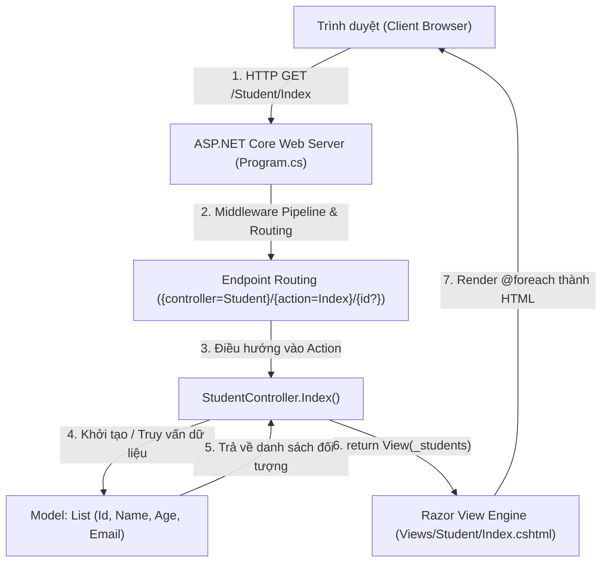
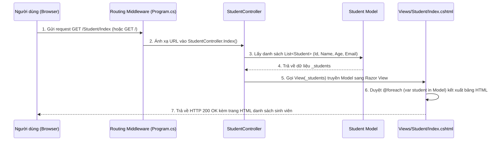
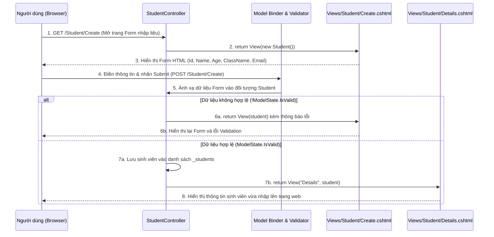

# Bài Tập Ngày 29/10/2026 - ASP.NET Core MVC (Student & Student Form)

Thư mục này bao gồm 2 bài tập về nhà được giao ngày **29/10/2026** (Hạn nộp: 30/10/2026) trên Google Classroom lớp `AAHN_C2411L`:

1. **`Bai1_StudentListMvc`** — **MVC - Homework - Student**:
   - Cho danh sách sinh viên (`Id`, `Name`, `Age`, `Email`).
   - Tạo ứng dụng MVC để hiển thị toàn bộ danh sách đó.
   - Trình bày chi tiết luồng chạy (Request Lifecycle) để hiển thị được danh sách sinh viên.
2. **`Bai2_StudentFormMvc`** — **MVC - Homework - Student Form**:
   - Tạo Form nhập liệu thông tin sinh viên và hiển thị chúng lên trang web thông qua ứng dụng MVC.

---

## Phần 1: Bài 1 - Hiển Thị Danh Sách Sinh Viên & Luồng Chạy MVC (`Bai1_StudentListMvc`)

### 1.1. Sơ Đồ Kiến Trúc & Luồng Chạy Tổng Thể (MVC Architecture Flow)

### 1.2. Sơ Đồ Trình Tự Hiển Thị Danh Sách Sinh Viên (Sequence Diagram)

### 1.3. Giải Thích Chi Tiết Từng Bước Luồng Chạy (Trả Lời Câu Hỏi Đề Bài)

1. **Bước 1 — Khởi tạo ứng dụng & Cấu hình Routing (`Program.cs`):**
   - Ứng dụng đăng ký dịch vụ MVC thông qua `builder.Services.AddControllersWithViews();`.
   - Cấu hình mẫu định tuyến mặc định: `pattern: "{controller=Student}/{action=Index}/{id?}"`. Khi người dùng truy cập trang chủ `/` hoặc `/Student/Index`, hệ thống tự động gọi đến `StudentController` và thực thi action `Index()`.
2. **Bước 2 — Tiếp nhận Request tại Controller (`Controllers/StudentController.cs`):**
   - Phương thức `[HttpGet] public IActionResult Index()` được kích hoạt.
   - Controller chuẩn bị danh sách `List<Student>` chứa các đối tượng sinh viên từ lớp `Models/Student.cs` (gồm 4 thuộc tính: `Id`, `Name`, `Age`, `Email`).
3. **Bước 3 — Truyền Model sang View (`return View(_students)`):**
   - Controller đóng gói danh sách `_students` và gọi `return View(_students);`.
   - Theo quy ước đặt tên (Convention over Configuration) của ASP.NET Core MVC, hệ thống tự động tìm file View tại đường dẫn `Views/Student/Index.cshtml`.
4. **Bước 4 — Kết xuất giao diện tại View (`Views/Student/Index.cshtml`):**
   - View khai báo `@model IEnumerable<Bai1_StudentListMvc.Models.Student>` để nhận danh sách sinh viên kiểu mạnh (Strongly-Typed View).
   - Sử dụng vòng lặp `@foreach (var student in Model)` để lấy từng thuộc tính `@student.Id`, `@student.Name`, `@student.Age`, `@student.Email` và tạo các dòng `<tr><td>...</td></tr>` trong bảng HTML.
5. **Bước 5 — Trả về HTTP Response:**
   - Razor View Engine kết hợp nội dung của `Index.cshtml` với bố cục chung `Views/Shared/_Layout.cshtml` để tạo thành tài liệu HTML hoàn chỉnh và gửi trả về trình duyệt của người dùng.

---

## Phần 2: Bài 2 - Form Nhập Liệu Thông Tin Sinh Viên (`Bai2_StudentFormMvc`)

### 2.1. Sơ Đồ Trình Tự Nhập Liệu Và Hiển Thị Sinh Viên (GET & POST Flow)

### 2.2. Các Thành Phần Chính Trong `Bai2_StudentFormMvc`

- **`Models/Student.cs`**: Định nghĩa lớp `Student` kèm các Data Annotations (`[Required]`, `[StringLength]`, `[Range]`, `[EmailAddress]`, `[Display]`) để kiểm tra dữ liệu đầu vào.
- **`Controllers/StudentController.cs`**:
  - `[HttpGet] Create()`: Trả về trang Form nhập liệu trống.
  - `[HttpPost] Create(Student student)`: Nhận dữ liệu người dùng gửi lên thông qua cơ chế **Model Binding**, kiểm tra `ModelState.IsValid`, lưu vào danh sách và trả về View `Details` hiển thị thông tin sinh viên vừa nhập.
  - `[HttpGet] Index()`: Hiển thị bảng toàn bộ các sinh viên đã nhập.
- **`Views/Student/Create.cshtml` & `Details.cshtml`**: Sử dụng Tag Helpers (`asp-controller`, `asp-action`, `asp-for`, `asp-validation-for`) để gắn kết trực tiếp các ô `<input>` với thuộc tính của `Student`.
