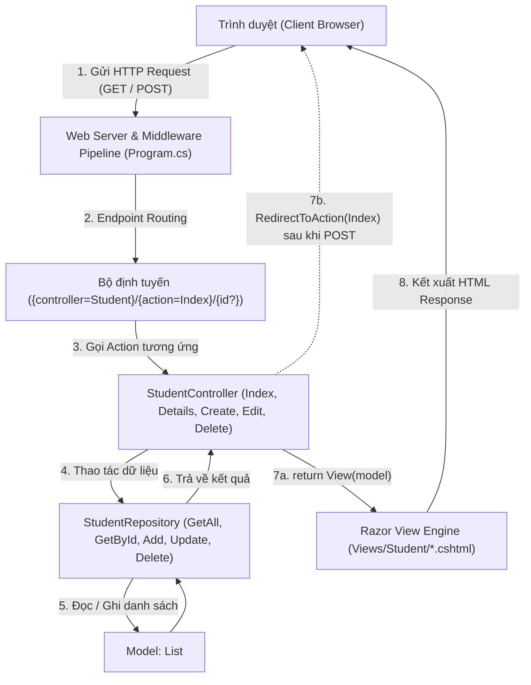
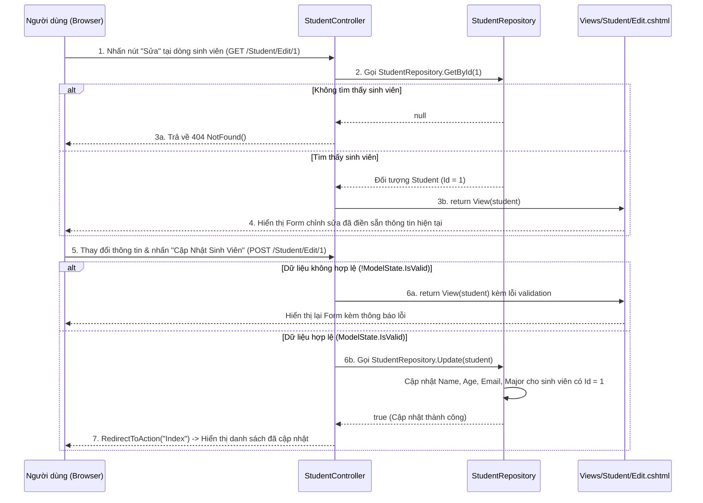

# Bài Tập Ngày 31/10/2026 - MVC Source Code Mẫu (`MvcHttpDemo`)

Bài tập ngày **31/10/2026** trên Google Classroom lớp `AAHN_C2411L`:
- Tham khảo source mẫu demo luồng chạy MVC và quản lý cơ bản đối tượng sinh viên (`Student`).
- Trả lời 2 yêu cầu trọng tâm:
  1. **Luồng chạy của ứng dụng MVC như thế nào?**
  2. **Thêm chức năng sửa sinh viên (`Edit`) cho hoàn thiện chương trình.**

---

## Câu 1: Luồng Chạy Của Ứng Dụng MVC Như Thế Nào?

### 1.1. Sơ Đồ Kiến Trúc Luồng Chạy Tổng Thể (`MvcHttpDemo`)



### 1.2. Giải Thích Chi Tiết Từng Bước Trong Luồng Chạy

1. **Tiếp nhận HTTP Request (`Program.cs`):**
   - Khi người dùng truy cập URL trên trình duyệt (ví dụ: `GET /Student/Index`, `GET /Student/Edit/1`, hoặc gửi Form `POST /Student/Edit/1`), Web Server tiếp nhận HTTP Request.
   - Request đi qua các Middleware cơ bản: `UseHttpsRedirection()`, `UseStaticFiles()`, `UseRouting()`, `UseAuthorization()`.
2. **Định tuyến Request (Routing):**
   - `MapControllerRoute` phân tích URL theo cấu trúc `{controller=Student}/{action=Index}/{id?}`:
     - Thành phần thứ nhất xác định **Controller** (`StudentController`).
     - Thành phần thứ hai xác định **Action Method** (`Index`, `Details`, `Create`, `Edit`, `Delete`).
     - Thành phần thứ ba (tùy chọn) là tham số định danh **`id`** của sinh viên.
3. **Xử lý điều phối tại Controller (`Controllers/StudentController.cs`):**
   - Đối với request `GET`: Controller gọi `StudentRepository` để lấy danh sách sinh viên hoặc tìm 1 sinh viên theo `id`, sau đó truyền đối tượng `Student` sang View thông qua `return View(model);`.
   - Đối với request `POST`: Cơ chế **Model Binding** tự động ánh xạ các trường dữ liệu từ Form (`Id`, `Name`, `Age`, `Email`, `Major`) vào đối tượng `Student`. Controller kiểm tra tính hợp lệ qua `ModelState.IsValid`, gọi `StudentRepository` để lưu/cập nhật dữ liệu, rồi điều hướng về trang danh sách bằng `RedirectToAction("Index")` (mẫu **PRG — Post/Redirect/Get** tránh gửi lặp lại Form khi F5).
4. **Tầng dữ liệu Model & Repository (`Models/Student.cs` & `Models/StudentRepository.cs`):**
   - `Student`: Định nghĩa cấu trúc dữ liệu của một sinh viên và các quy tắc kiểm tra hợp lệ (Data Annotations).
   - `StudentRepository`: Quản lý danh sách `_students` trong bộ nhớ với đầy đủ các phương thức `GetAll()`, `GetById()`, `Add()`, `Update()`, `Delete()`.
5. **Hiển thị giao diện tại View (`Views/Student/*.cshtml`):**
   - Razor View nhận dữ liệu từ Controller, kết hợp với Layout chung (`Views/Shared/_Layout.cshtml`) để sinh mã HTML và trả về cho trình duyệt hiển thị.

---

## Câu 2: Thêm Chức Năng Sửa Sinh Viên (`Edit`) Cho Hoàn Thiện Chương Trình

### 2.1. Sơ Đồ Trình Tự Luồng Chạy Chức Năng Sửa Sinh Viên (`Edit` GET & POST)



### 2.2. Các Phần Code Đã Bổ Sung Để Hoàn Thiện Chức Năng Sửa Sinh Viên

1. **Tại `Models/StudentRepository.cs` — Bổ sung hàm `Update(Student updatedStudent)`:**
   ```csharp
   public static bool Update(Student updatedStudent)
   {
       var existing = GetById(updatedStudent.Id);
       if (existing == null)
       {
           return false;
       }

       existing.Name = updatedStudent.Name;
       existing.Age = updatedStudent.Age;
       existing.Email = updatedStudent.Email;
       existing.Major = updatedStudent.Major;
       return true;
   }
   ```
2. **Tại `Controllers/StudentController.cs` — Bổ sung cặp Action `Edit` (`[HttpGet]` và `[HttpPost]`):**
   - `[HttpGet] public IActionResult Edit(int id)`: Tìm sinh viên theo `id` từ `StudentRepository.GetById(id)` và nạp dữ liệu cũ vào Form `Views/Student/Edit.cshtml`.
   - `[HttpPost] public IActionResult Edit(int id, Student student)`: Kiểm tra `id == student.Id` và `ModelState.IsValid`, gọi `StudentRepository.Update(student)` để lưu thay đổi và chuyển hướng về `Index`.
3. **Tại `Views/Student/Edit.cshtml` & `Views/Student/Index.cshtml`:**
   - Thêm nút `<a asp-action="Edit" asp-route-id="@student.Id">Sửa</a>` trên từng dòng sinh viên ở trang `Index.cshtml`.
   - Tạo trang `Edit.cshtml` chứa `<input type="hidden" asp-for="Id" />` và các ô nhập liệu gắn `asp-for` để người dùng chỉnh sửa trực tiếp thông tin và lưu lại.
